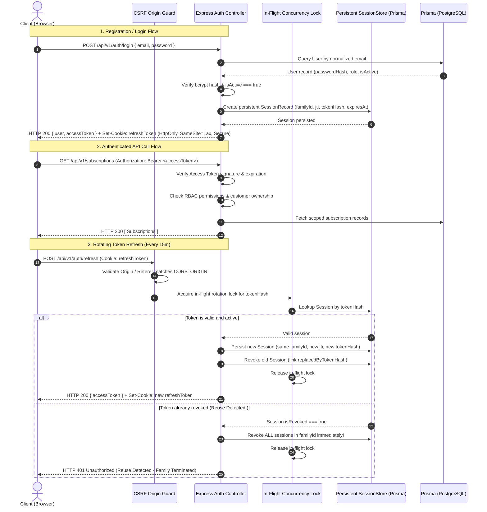

# Brightloop Subscription Management System — Authentication Architecture Specification

> **Document Version:** 1.1 (Security Hardened & Audited)  
> **Security Level:** Enterprise Grade  
> **Target Frameworks:** Express.js 4 (Node.js 20) & React 18 (Vite)  
> **Database ORM:** Prisma ORM 5.x on PostgreSQL 16  
> **Audit Reference:** Master Prompt 04A Security Audit

---

## 1. Architectural Overview

Brightloop implements a defense-in-depth, token-based authentication and authorization architecture with persistent session lifecycle tracking:
1. **Short-Lived Access Tokens:** Signed JWTs (15-minute validity) stored strictly in client memory. Never persisted to `localStorage` or `sessionStorage` to eliminate Cross-Site Scripting (XSS) token theft vulnerabilities.
2. **Rotating Refresh Tokens in HttpOnly Cookies:** Long-lived tokens (7-day validity) transmitted via secure, HttpOnly, SameSite cookies with strict path isolation (`/api/v1/auth`). Every refresh cycle issues a new refresh token and revokes the prior token JTI, providing guaranteed replay attack detection.
3. **Persistent Session & Token Family Tracking:** Backed by persistent storage (`RefreshTokenSession` model). Refresh token hashes (SHA-256) are stored, linking tokens to a session family (`familyId`). Any replay of an already rotated or revoked token triggers immediate revocation of the entire token family.
4. **In-Flight Refresh Concurrency Lock:** Simultaneous requests carrying the identical refresh token are tracked; exactly one rotation completes while duplicate concurrent attempts fail safely, eliminating race conditions.
5. **Strict Server-Side Role Enforcement:** The database assigns and validates account roles (`ADMIN`, `STAFF`, `CUSTOMER`). Public registration is strictly restricted to `CUSTOMER` role.
6. **Backend Customer Data Ownership Guard:** Customer access is verified at the controller/middleware layer by matching the authenticated user profile ID against the requested resource ID, ensuring URL parameter tampering returns HTTP `403 Forbidden`.
7. **CSRF Defense on Cookie Endpoints:** Cookie-authenticated endpoints (`/refresh`, `/logout`) verify the `Origin` and `Referer` headers against allowed origins (`CORS_ORIGIN`, `FRONTEND_URL`), preventing cross-site request exploitation.



---

## 2. Token Specifications & Cryptography

### Access Token
- **Format:** JSON Web Token (JWT), RFC 7519
- **Algorithm:** HMAC-SHA256 (`HS256`)
- **Secret:** `JWT_ACCESS_SECRET` (Minimum 32 characters)
- **Lifetime:** 15 minutes (`15m`)
- **Payload Claims:**
  ```json
  {
    "sub": "b2f67a21-9988-43f1-b842-bc05ecb12345",
    "email": "customer@brightloop.io",
    "role": "CUSTOMER",
    "type": "access",
    "iat": 1730370000,
    "exp": 1730370900
  }
  ```

### Refresh Token
- **Format:** JSON Web Token (JWT) with UUIDv4 JTI and Family ID
- **Algorithm:** HMAC-SHA256 (`HS256`)
- **Secret:** `JWT_REFRESH_SECRET` (Distinct from Access Secret)
- **Lifetime:** 7 days (`7d`)
- **Payload Claims:**
  ```json
  {
    "sub": "b2f67a21-9988-43f1-b842-bc05ecb12345",
    "jti": "e4f8d29b-73c1-4b72-a1f9-918d3ef84120",
    "familyId": "8a011cd2-9844-42b7-a3cf-7e871e892e5f",
    "type": "refresh",
    "iat": 1730370000,
    "exp": 1730974800
  }
  ```

---

## 3. Persistent Session Storage Specification

Persistent storage ensures token revocations and active sessions persist across backend service restarts and horizontal worker scaling.

### Schema: `RefreshTokenSession`
```prisma
model RefreshTokenSession {
  id                  String    @id @default(uuid())
  userId              String    @map("user_id")
  tokenHash           String    @unique @map("token_hash")
  familyId            String    @map("family_id")
  jti                 String    @unique @map("jti")
  expiresAt           DateTime  @map("expires_at")
  isRevoked           Boolean   @default(false) @map("is_revoked")
  revokedAt           DateTime? @map("revoked_at")
  replacedByTokenHash String?   @map("replaced_by_token_hash")
  ipAddress           String?   @map("ip_address")
  userAgent           String?   @map("user_agent")
  createdAt           DateTime  @default(now()) @map("created_at")
  updatedAt           DateTime  @updatedAt @map("updated_at")

  user User @relation(fields: [userId], references: [id], onDelete: Cascade)

  @@index([userId])
  @@index([familyId])
  @@index([tokenHash])
  @@index([expiresAt])
  @@map("refresh_token_sessions")
}
```

### Session Lifecycle Management:
- **Hash Storage:** Only SHA-256 hashes (`hashToken(rawToken)`) are stored. Database compromises do not reveal raw refresh tokens.
- **Single Logout:** `POST /api/v1/auth/logout` looks up the token hash and revokes that specific session record.
- **Global Logout / Password Reset:** `sessionStore.revokeAllUserSessions(userId)` sets `isRevoked: true` and `revokedAt: now()` on all active sessions for that user.
- **Family Revocation:** `sessionStore.revokeFamily(familyId)` invalidates all active sessions in the token lineage when reuse is detected.

---

## 4. Password Security Standards & Bcrypt Audit

### Enforced Rules
- **Minimum Length:** Must contain **MORE THAN 8 characters** (`>= 9` characters).
- **Maximum Length Guard:** Must not exceed **72 UTF-8 bytes** (`Buffer.byteLength(password, 'utf8') <= 72`).
  - *Audit Finding:* Standard bcrypt silently truncates passwords after 72 bytes. Without strict pre-hashing byte-length checks, `Password123!abc...` and `Password123!xyz...` with differing characters beyond byte 72 produce identical hashes. Brightloop enforces strict rejection on input strings exceeding 72 bytes.
- **Unicode Normalization:** All inputs undergo canonical Unicode normalization (`normalize('NFKC')`) prior to length validation, hashing, and comparison, preventing visual spoofing and character representation mismatches.
- **Complexity Requirements:**
  - At least one uppercase letter (`[A-Z]`).
  - At least one lowercase letter (`[a-z]`).
  - At least one special character (`[!@#$%^&*()_+\-=[\]{};':"\\|,.<>/?~`]`).
- **Hashing Algorithm:** `bcryptjs` with **Work Factor 12** (`BCRYPT_SALT_ROUNDS = 12`).

### Argon2id Recommendation
Argon2id is the winner of the Password Hashing Competition (PHC) and provides superior resistance against GPU/ASIC hardware cracking attacks through configurable memory hardness. 
- *Current Status:* `bcryptjs` (cost 12) is fully functional, cross-platform compatible without native C++ compilation bindings, and passing all security tests.
- *Recommendation:* Retain `bcryptjs` with 72-byte guard for current milestone. Transition to `argon2id` (using `@node-rs/argon2` or native bindings) in the future production deployment hardening phase using an automated progressive rehashing upgrade pattern on user sign-in.

---

## 5. Single-Use Password Reset Engine

1. User requests password reset via `POST /api/v1/auth/forgot-password`.
2. System computes normalized email and checks DB asynchronously.
3. Regardless of existence, API returns generic message: `"If an account exists with this email address, you will receive a password reset link shortly."` (Zero user enumeration).
4. For valid users, system generates a 32-byte cryptographically secure random token (`crypto.randomBytes(32).toString('hex')`).
5. Only the SHA-256 hash of the token (`hashToken(rawToken)`) is stored in `PasswordResetToken` alongside a 60-minute expiration timestamp (`expiresAt = now() + 1 hour`).
6. Raw token is dispatched via email link (`/reset-password?token=<rawToken>`).
7. **Atomic Single-Use Consumption:**
   - Password reset uses `prisma.passwordResetToken.updateMany({ where: { tokenHash, usedAt: null, expiresAt: { gt: now } }, data: { usedAt: now } })`.
   - If `count === 0`, the reset attempt is rejected immediately, guaranteeing race-free single-use semantics.
8. **Production SMTP Fail-Safe:**
   - If SMTP credentials are not configured in production (`NODE_ENV === 'production'`), the email dispatch fails safely without throwing unhandled exceptions, and raw reset URLs are strictly suppressed from application logs.

---

## 6. Cookie, CORS & CSRF Hardening

| Control | Setting / Implementation | Rationale |
|---|---|---|
| `HttpOnly` | `true` | Prevents malicious client-side JavaScript / XSS scripts from accessing the refresh cookie. |
| `Secure` | `true` in production (`NODE_ENV === 'production'`) | Enforces TLS/HTTPS transport; allows local HTTP testing in development. |
| `SameSite` | `lax` | Defends against cross-site request forgery on third-party links. |
| `Path` | `/api/v1/auth` | Scopes cookie transmission strictly to authentication and rotation endpoints. |
| `CORS Origin` | Explicit callback validation; rejects `*` | In `app.ts`, wildcard origins are strictly forbidden when credentials are enabled. |
| `CSRF Origin Check` | `verifyCsrfOrigin` middleware | Validates `req.headers.origin` and `req.headers.referer` on `/refresh` and `/logout`. |
