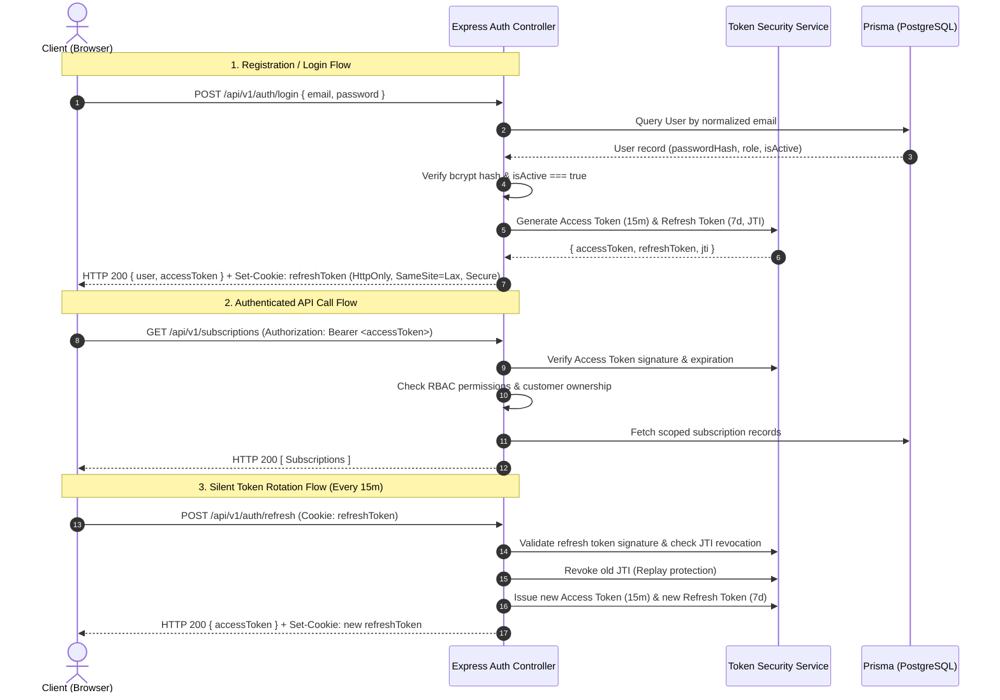

# Brightloop Subscription Management System — Authentication Architecture Specification

> **Document Version:** 1.0  
> **Security Level:** Enterprise Grade  
> **Target Frameworks:** Express.js 4 (Node.js 20) & React 18 (Vite)  
> **Database ORM:** Prisma ORM 5.x on PostgreSQL 16

---

## 1. Architectural Overview

Brightloop implements a defense-in-depth, stateless token-based authentication and authorization architecture designed around:
1. **Short-Lived Access Tokens:** Signed JWTs (15-minute validity) stored strictly in client memory. Never persisted to `localStorage` or `sessionStorage` to eliminate Cross-Site Scripting (XSS) token theft vulnerabilities.
2. **Rotating Refresh Tokens in HttpOnly Cookies:** Long-lived tokens (7-day validity) transmitted via secure, HttpOnly, SameSite cookies with strict path isolation (`/api/v1/auth`). Every refresh cycle issues a new refresh token and revokes the prior token JTI, providing guaranteed replay attack detection.
3. **Strict Server-Side Role Enforcement:** The database assigns and validates account roles (`ADMIN`, `STAFF`, `CUSTOMER`). Public registration is strictly restricted to `CUSTOMER` role.
4. **Backend Customer Data Ownership Guard:** Customer access is verified at the controller/middleware layer by matching the authenticated user profile ID against the requested resource ID, ensuring URL parameter tampering returns HTTP `403 Forbidden`.



---

## 2. Token Specifications & Cryptography

### Access Token
- **Format:** JSON Web Token (JWT), RFC 7519
- **Algorithm:** HMAC-SHA256 (`HS256`)
- **Secret:** `JWT_ACCESS_SECRET` (Minimum 32 characters)
- **Lifetime:** 15 minutes (`15m`)
- **Payload Claims:**
  ```json
  {
    "sub": "b2f67a21-9988-43f1-b842-bc05ecb12345",
    "email": "customer@brightloop.io",
    "role": "CUSTOMER",
    "type": "access",
    "iat": 1730370000,
    "exp": 1730370900
  }
  ```

### Refresh Token
- **Format:** JSON Web Token (JWT) with UUIDv4 JTI
- **Algorithm:** HMAC-SHA256 (`HS256`)
- **Secret:** `JWT_REFRESH_SECRET` (Distinct from Access Secret)
- **Lifetime:** 7 days (`7d`)
- **Payload Claims:**
  ```json
  {
    "sub": "b2f67a21-9988-43f1-b842-bc05ecb12345",
    "jti": "e4f8d29b-73c1-4b72-a1f9-918d3ef84120",
    "type": "refresh",
    "iat": 1730370000,
    "exp": 1730974800
  }
  ```

---

## 3. Cookie Storage Policy

Refresh tokens are exclusively issued in HTTP response headers with the following directive flags:

| Attribute | Value | Security Rationale |
|---|---|---|
| `HttpOnly` | `true` | Prevents malicious JavaScript / XSS scripts from reading or stealing the token. |
| `Secure` | `true` (Production) | Enforces transport over encrypted TLS/HTTPS connections. |
| `SameSite` | `lax` | Defends against Cross-Site Request Forgery (CSRF) on external navigation. |
| `Path` | `/api/v1/auth` | Restricts cookie transmission strictly to authentication and rotation endpoints. |
| `Max-Age` | `604800` (7 Days) | Automatically purges expired sessions at the browser engine level. |

---

## 4. Password Security Standards

Brightloop enforces high-entropy password requirements matching NIST 800-63B recommendations:
- **Minimum Length:** Must contain **MORE THAN 8 characters** (`>= 9` characters).
- **Complexity Requirements:**
  - At least one uppercase Latin letter (`[A-Z]`).
  - At least one lowercase Latin letter (`[a-z]`).
  - At least one special character (`[!@#$%^&*()_+\-=[\]{};':"\\|,.<>/?~`]`).
- **Hashing Algorithm:** `bcrypt` with **Work Factor 12** (`BCRYPT_SALT_ROUNDS = 12`), generating 4,096 hashing iterations per password.

---

## 5. Single-Use Password Reset Engine

1. User requests password reset via `POST /api/v1/auth/forgot-password`.
2. System computes normalized email and checks DB asynchronously.
3. Regardless of existence, API returns generic message: `"If an account exists with this email address, you will receive a password reset link shortly."` (Zero user enumeration).
4. For valid users, system generates a 32-byte cryptographically secure random token (`crypto.randomBytes(32).toString('hex')`).
5. Only the SHA-256 hash of the token (`hashToken(rawToken)`) is stored in `PasswordResetToken` alongside a 60-minute expiration timestamp (`expiresAt = now() + 1 hour`).
6. Raw token is dispatched via email link (`/reset-password?token=<rawToken>`).
7. When submitted, the token hash is verified, marked `usedAt = now()`, and all active user sessions are revoked (`revokeAllUserTokens(userId)`).
