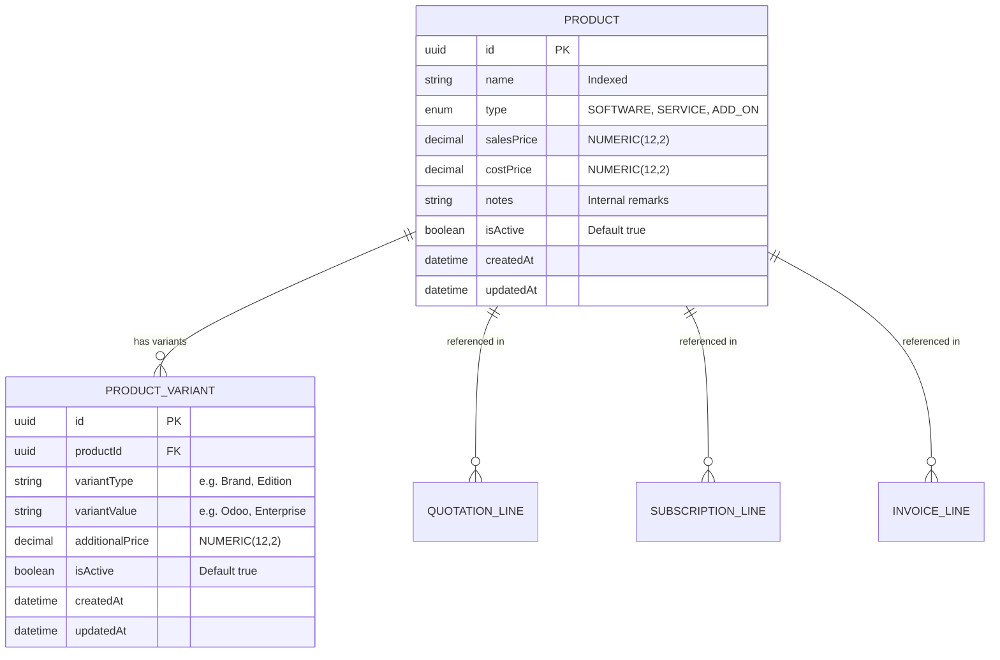

# Brightloop Subscription Management System — Product Management Module Specification

> **Document Version:** 1.0  
> **Module Identifier:** M02 — Product Management & Catalog  
> **Target Frameworks:** Express.js 4 (Node.js 20) & React 18 (Vite, Tailwind CSS)  
> **Database ORM:** Prisma ORM 5.x on PostgreSQL 16  
> **Business Reference:** Original Problem Statement PDF (`Subscription_Management_System.pdf`)

---

## 1. Executive Summary & Business Scope

The Product Management module forms the commercial catalog foundation of Brightloop. It manages the software products, consulting services, and add-on extensions that Brightloop sells on recurring (monthly/annual) and one-time terms.

### Key Architectural Pillars:
1. **Additive Variant Surcharge Engine:** Products support additive configurations and editions. For example, a base product priced at $1,000.00 combined with an Odoo variant at +$560.00 calculates cleanly to a $1,560.00 selling price.
2. **Exact Financial Precision:** All prices and surcharges are stored and computed using PostgreSQL `NUMERIC(12, 2)` mapped through Prisma `Decimal`. Floating-point arithmetic is strictly prohibited in financial paths.
3. **Role-Based Catalog Visibility & Data Sanitization:**
   - **`ADMIN`:** Full CRUD access, variant management, profit margin analysis, internal notes, and cost prices.
   - **`STAFF`:** Operational catalog browsing, variant selection, and operational notes. Cost price is strictly stripped. Cannot create, edit, or delete products.
   - **`CUSTOMER`:** Self-service catalog browsing and dynamic pricing preview for active products. Cost prices and internal notes are strictly omitted.
4. **Historical Audit & Financial Integrity Guard:**
   - Updating a product's current catalog sales price does **not** alter existing quotations, subscriptions, or invoice line items.
   - Products referenced by active or historical financial records cannot be physically deleted; they must be deactivated instead to preserve accounting auditability.

---

## 2. Domain Models & Schema Structure



### Uniqueness Strategy for ProductVariant:
- Constraint: `@@unique([productId, variantType, variantValue])`
- **Architectural Rationale:** Enforcing uniqueness across `[productId, variantType, variantValue]` allows a single product to offer multiple values within the same variant category (e.g., `variantType: 'Edition'` with values `'Community'` and `'Enterprise'`; or `variantType: 'Configuration'` with values `'Odoo'` and `'Custom Addon'`). A narrower constraint on `[productId, variantType]` would incorrectly restrict each category to a single option.

---

## 3. Product Types Supported

| Enum Value | Classification | Typical Use Case |
|---|---|---|
| **`SOFTWARE`** | Core Platform License | Primary recurring software subscriptions (e.g. ERP core, CRM system). |
| **`SERVICE`** | Professional Services | Onboarding, implementation consulting, migration assistance, and SLA support. |
| **`ADD_ON`** | Feature Extensions | User seat packs, extra storage, API integrations, and optional modules. |

---

## 4. Product Lifecycle & Historical Integrity Rules

1. **Transactional Creation:**
   - Creating a product along with initial variants executes inside an ACID database transaction (`prisma.$transaction`).
   - Duplicate product names (case-insensitive) are rejected with HTTP `409 Conflict`.
2. **Safe Deactivation / Archiving:**
   - Deactivating a product (`PATCH /api/v1/products/:id/status { isActive: false }`) hides it from customer self-service catalogs and prevents new quotations from selecting it.
   - Existing subscriptions and invoices continue to reference historical product data without interruption.
3. **Physical Deletion Reference Check:**
   - If an Admin attempts to delete a product (`DELETE /api/v1/products/:id`), the service queries related financial line items:
     - `quotationLines`
     - `subscriptionLines`
     - `invoiceLines`
     - `quotationTemplateLines`
   - If any references exist (`refCount > 0`), the request is rejected with HTTP `409 Conflict`:
     `"Cannot delete product '...': It is referenced by X existing historical records. Please deactivate the product instead."`
   - If zero references exist, physical deletion proceeds safely.

---

## 5. Frontend Pages & User Workflows

| Page Route | Access Control | Primary Features |
|---|---|---|
| `/products` | `ADMIN`, `STAFF`, `CUSTOMER` | Metrics dashboard, searchable catalog table, type/status filter dropdowns, pagination, role-aware action controls. |
| `/products/new` | `ADMIN` Only | Creation form, cost price input, margin calculator, dynamic variant row builder, live pricing preview. |
| `/products/:id` | `ADMIN`, `STAFF`, `CUSTOMER` | Product overview, variant catalog, **interactive live pricing calculator** with multi-variant selection and exact Decimal breakdown. |
| `/products/:id/edit` | `ADMIN` Only | Attribute editing, status toggle, variant addition and deletion with historical reference guards. |

---

## 6. Pending PostgreSQL Verification

- **Status:** Offline (Deferred activation).
- **Client Preparation:** `@prisma/client` is generated with `Product` and `ProductVariant` models.
- **Verification Completed:** 10 test suites (67 automated tests) verified with in-memory and mocked database adapters.
- **Next Live Activation Step:** When PostgreSQL 16 is started via Docker, deploy migrations:
  ```bash
  npx prisma migrate dev --name init_and_sessions
  ```
